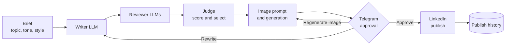
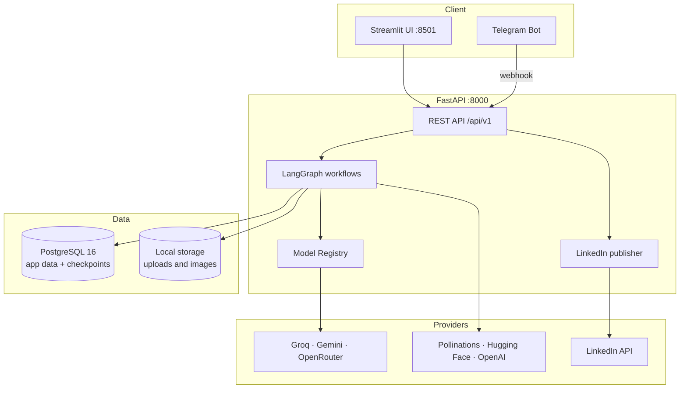

<h1 align="center">LinkedIn AI Agent</h1>

<p align="center">
  A multi-model, human-in-the-loop content agent that drafts, reviews, illustrates, and publishes LinkedIn posts — built on LangGraph, FastAPI, PostgreSQL, and Streamlit.
</p>

<p align="center">
  
  
  
  
  
  
</p>

---

<p align="center">
  <svg xmlns="http://www.w3.org/2000/svg" viewBox="0 0 1200 627" width="1200" height="627" role="img" aria-label="LinkedIn AI Agent: brief, writer, review and judge, visuals, Telegram approval, LinkedIn publishing" xmlns:c2pa="http://c2pa.org/manifest">
</p>

## Overview

LinkedIn AI Agent turns a short brief (topic, audience, tone, style) into a polished LinkedIn post, then keeps **you** in control of what gets published.

Instead of one prompt and one model, the agent runs a stateful multi-step workflow: a **writer** drafts, **reviewers** critique, a **judge** scores and selects, an **image pipeline** produces visuals, and you approve the result from your phone through **Telegram** before anything reaches LinkedIn.

The project is designed for a **free-tier stack** (Groq, Gemini, OpenRouter, Pollinations, local PostgreSQL) and is structured from day one to grow into a multi-user SaaS.

## Highlights

- **Multi-agent workflow** — writer, reviewer, judge, and translator roles, orchestrated with LangGraph and checkpointed in PostgreSQL.
- **Bring any model** — register models from Groq, Google Gemini, or OpenRouter and assign each one a role through the Model Registry. API keys can be stored encrypted per model.
- **Human approval via Telegram** — inline buttons for approve, rewrite, and regenerate, with the selected image delivered in the same chat.
- **AI image generation with fallbacks** — Pollinations by default (no key needed), with Hugging Face and OpenAI as configurable fallbacks.
- **LinkedIn OAuth and publishing** — text and image posts, retries for transient errors, publish history, and a `LINKEDIN_DRY_RUN` mode for safe testing.
- **Post version history** — every rewrite or regeneration is stored, so you can compare versions and roll back.
- **Security-first repo** — encrypted provider tokens (Fernet), secret scanning with `detect-secrets` and Gitleaks, and production settings that reject placeholder secrets.

## How It Works



1. **Brief** — you describe the post in the Streamlit UI: topic, objective, audience, language, tone, length, CTA type, emoji level, and hashtag mode.
2. **Write** — the Writer model drafts the post, including a hook and call to action.
3. **Review and judge** — reviewer models critique the draft and the judge scores and selects the best version. Each iteration is saved as a post version.
4. **Visuals** — an image prompt is generated from the post, and images are produced through the provider fallback chain.
5. **Approve** — the draft and images arrive in Telegram. You approve, ask for a rewrite, or regenerate.
6. **Publish** — on approval, the post is published to LinkedIn through OAuth, with retries and idempotent publish history.

## Architecture



| Layer | Technology | Role |
| --- | --- | --- |
| Frontend | Streamlit | Post creation and management UI |
| API | FastAPI | REST endpoints, Telegram webhook, LinkedIn OAuth callback |
| Workflows | LangGraph | Stateful multi-agent graphs with PostgreSQL checkpointing |
| Database | PostgreSQL 16, SQLAlchemy, Alembic | Application data, migrations, workflow state |
| Storage | Local filesystem (Supabase Storage planned) | Uploads and generated images |
| Delivery | Docker Compose | One-command local environment |

## Project Status

| Area | Status |
| --- | --- |
| Groq, Gemini, and OpenRouter model adapters | Implemented |
| Model Registry with per-model roles and encrypted keys | Implemented |
| Pollinations, Hugging Face, and OpenAI image adapters | Implemented |
| Telegram approval workflow | Implemented |
| LinkedIn OAuth and publishing (with dry-run mode) | Implemented |
| Local PostgreSQL and local storage | Implemented |
| User registration, login, and JWT enforcement | In progress |
| Supabase Storage backend | Configured, not yet implemented |
| Scheduled publishing and periodic jobs (APScheduler) | Planned |
| CV-based job matching (Adzuna) | Planned |
| Profile optimizer workflow | Planned |
| Additional Streamlit feature pages | Planned |

> **Note:** The current `X-User-ID` header is a development-only identity boundary. Do not expose the application to the public internet until JWT registration, login, and bearer-token enforcement are in place.

## Getting Started

### Prerequisites

- Docker Desktop (Linux containers, Compose v2) or Docker Engine with Compose v2
- About 4 GB of free RAM and ports `5432`, `8000`, and `8501` available
- At least one text provider key (Groq, Gemini, or OpenRouter) for real AI workflows

No host Python installation is needed for the Docker path.

### 1. Clone

```bash
git clone https://github.com/mohamed-12-tarek/linkedin-ai-agent.git
cd linkedin-ai-agent
```

### 2. Configure the environment

```bash
cp .env.example .env
```

Generate unique local secrets and place them in `.env`:

```bash
# JWT_SECRET_KEY
python -c "import secrets; print(secrets.token_urlsafe(48))"

# ENCRYPTION_KEY (Fernet)
python -c "from cryptography.fernet import Fernet; print(Fernet.generate_key().decode())"
```

Then set `POSTGRES_PASSWORD` and build `DATABASE_URL` from your chosen database user, password, and database name. Inside Compose the database host is `db`.

### 3. Run

```bash
docker compose up -d
docker compose ps
```

The one-shot `migrations` service runs Alembic first and must finish successfully before the backend starts.

### 4. Open

| Service | URL |
| --- | --- |
| Streamlit UI | http://localhost:8501 |
| API docs (Swagger) | http://localhost:8000/docs |

### 5. Register your models

Before the writing workflow can run, register at least one model in the Model Registry and assign the **Writer**, **Reviewer**, **Judge**, and **Translator** roles. Image prompt generation reuses the Writer role.

## Configuration

Only configure the integrations you are actively testing. A full inventory of every variable lives in [`INTEGRATION_CHECKLIST.md`](INTEGRATION_CHECKLIST.md).

| Group | Key variables |
| --- | --- |
| Core | `APP_ENV`, `DATABASE_URL`, `BACKEND_URL`, `FRONTEND_URL`, `CORS_ORIGINS` |
| Security | `JWT_SECRET_KEY`, `ENCRYPTION_KEY` |
| Text models | `GROQ_API_KEY`, `GOOGLE_API_KEY`, `OPENROUTER_API_KEY` |
| Images | `IMAGE_PROVIDER_ORDER`, `POLLINATIONS_MODEL`, `HUGGINGFACE_API_TOKEN` |
| Telegram | `TELEGRAM_BOT_TOKEN`, `TELEGRAM_CHAT_ID`, `TELEGRAM_WEBHOOK_SECRET` |
| LinkedIn | `LINKEDIN_CLIENT_ID`, `LINKEDIN_CLIENT_SECRET`, `LINKEDIN_REDIRECT_URI`, `LINKEDIN_DRY_RUN` |
| Storage | `STORAGE_BACKEND`, `LOCAL_STORAGE_PATH` |

### Telegram approval

1. Create a bot with `@BotFather` and copy the token.
2. Set `TELEGRAM_BOT_TOKEN`, `TELEGRAM_CHAT_ID`, and `TELEGRAM_WEBHOOK_SECRET`.
3. Telegram must reach a public HTTPS URL, so for local development use a tunnel such as Cloudflare Tunnel or ngrok and register the webhook at:

```text
https://YOUR_PUBLIC_BACKEND_HOST/api/v1/telegram/webhook
```

### LinkedIn publishing

1. Create an app in the [LinkedIn Developer Portal](https://www.linkedin.com/developers/apps).
2. Request the `openid`, `profile`, and `w_member_social` scopes. Approval is granted by LinkedIn and is not automatic.
3. Register the OAuth callback exactly as configured:

```text
https://YOUR_PUBLIC_BACKEND_HOST/api/v1/linkedin/oauth/callback
```

Start with `LINKEDIN_DRY_RUN=true` to exercise the full flow, including publish history and idempotency, without posting anything.

## Data Model

The PostgreSQL schema is built for a future multi-tenant SaaS, even though it currently runs for a single user. Highlights:

- `users`, `settings` — identity and per-user defaults
- `llm_models`, `prompts`, `styles` — model registry with roles, reusable prompts, and writing styles
- `posts`, `post_versions`, `images` — drafts, full version history, and generated images
- `telegram_messages`, `schedules`, `publish_history`, `linkedin_accounts` — approval, scheduling, and publishing
- `cv_documents`, `job_listings`, `job_matches`, `profile_optimizations` — tables for the planned job-matching and profile features

The full diagram is in [`database_erd_en.md`](database_erd_en.md).

## Security

Security is treated as a feature of this repository:

- Provider and LinkedIn tokens are **encrypted at rest** with Fernet.
- `staging` and `production` modes **reject** the development JWT secret and invalid Fernet keys.
- **Secret scanning** runs through `detect-secrets` (pre-commit and GitHub Actions) and Gitleaks across the full Git history.
- Uploads, generated images, certificates, tokens, and `.env` files are never committed.

Enable the local hook with:

```bash
python -m pip install pre-commit detect-secrets==1.5.0
pre-commit install
pre-commit run --all-files
```

See [`SECURITY.md`](SECURITY.md) for the full policy.

## Operations Notes

- **Backups:** back up the `postgres_data` volume and `./storage` together. A database-only backup does not contain images or CV files.
- **Scheduler:** when scheduled publishing ships, run exactly one scheduler leader or add a database-backed lease.
- **Time zone:** set `SCHEDULER_TIMEZONE`; containers use UTC by default.
- **Hosting:** production Telegram webhooks and LinkedIn callbacks require a public HTTPS backend with a persistent container and PostgreSQL connectivity.

## Roadmap

- [x] Multi-model registry with role assignment
- [x] Writer, reviewer, and judge workflow with versioned drafts
- [x] AI image generation with provider fallbacks
- [x] Telegram human approval
- [x] LinkedIn OAuth and publishing
- [ ] JWT authentication and ownership enforcement
- [ ] Scheduled publishing
- [ ] CV upload and job matching with Adzuna
- [ ] Profile optimizer
- [ ] Supabase Storage backend
- [ ] Expanded Streamlit feature pages

## Documentation

- [`INTEGRATION_CHECKLIST.md`](INTEGRATION_CHECKLIST.md) — every external account, credential, callback, and environment variable
- [`database_erd_en.md`](database_erd_en.md) — full entity-relationship diagram
- [`SECURITY.md`](SECURITY.md) — secrets handling and production requirements
- [`privacy.html`](privacy.html) — privacy policy


## Author

**Mohamed Tarek** — [GitHub](https://github.com/mohamed-12-tarek)
