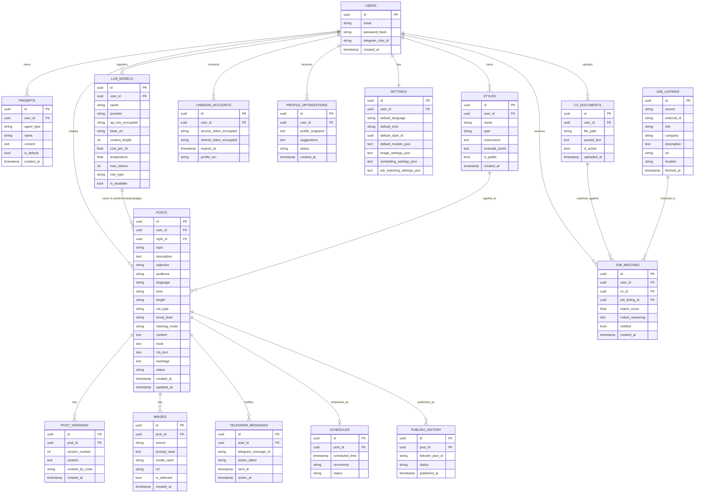

# ERD — AI LinkedIn Content Agent (Free-Tier Stack)

Database: PostgreSQL (free via Supabase Free Tier / Neon.tech Free Tier / local Docker)

## Mermaid ERD

## Design Notes

- **users**: Built from day one to support a future multi-tenant SaaS, even though the system will initially run for a single user.
- **llm_models**: Allows registering multiple models, each with a different `role_type` (writer, reviewer, judge, image, translation) — this is what enables Multi-Model Support.
- **post_versions**: Logs every Rewrite/Regenerate action so you can roll back to a previous version or track how a post evolved.
- **cv_documents + job_listings + job_matches**: The tables powering the job-matching feature — support multiple CVs, and store each match's score and reasoning (for transparency) plus notification status.
- **profile_optimizations**: Stores every time the system analyzed the profile and suggested improvements, along with the snapshot of text that was analyzed.
- **settings**: A 1-to-1 relationship with each user, holding job-matching settings (notification frequency, target keywords, target job title, etc.).
